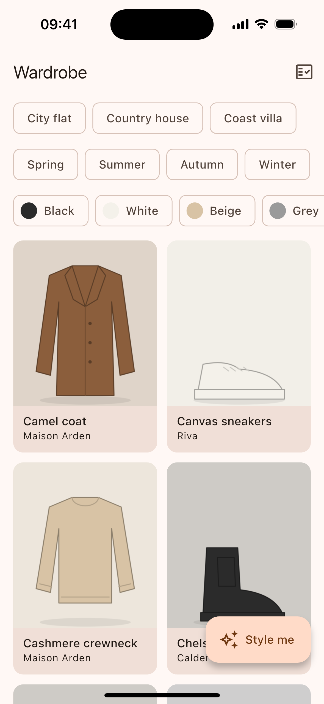
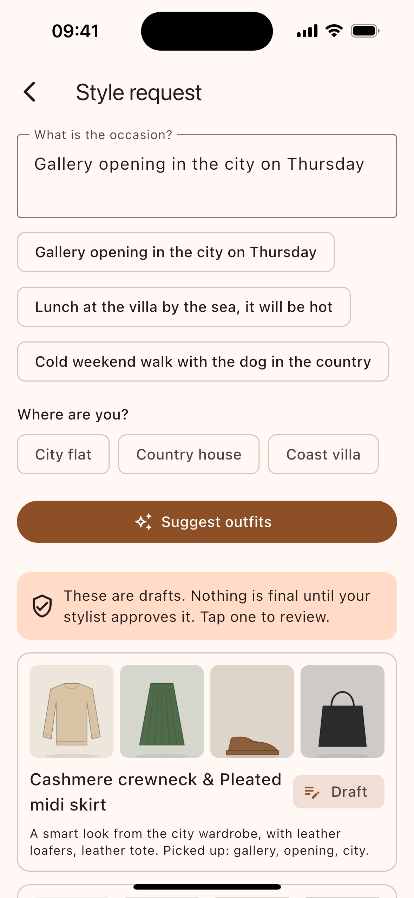
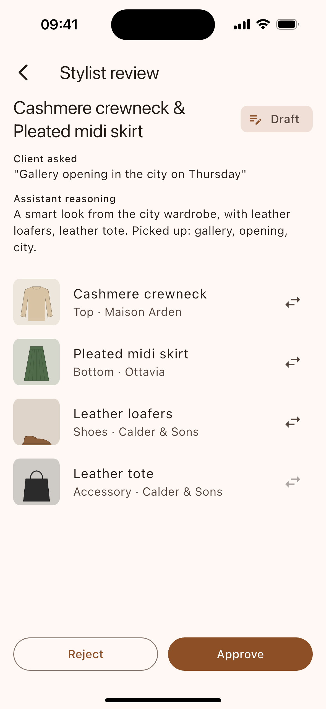
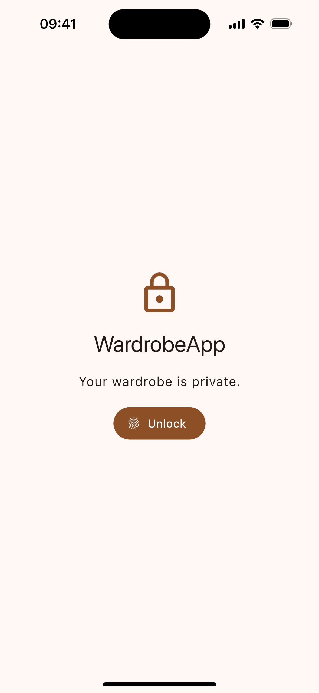
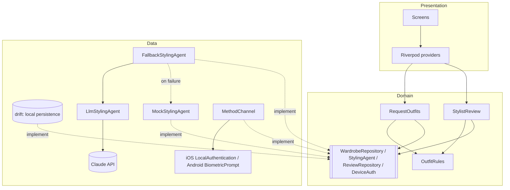
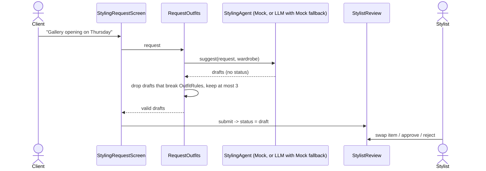

# WardrobeApp

[](https://github.com/AnastasiaZhdanova/WardrobeApp/actions/workflows/ci.yml)

WardrobeApp is a private wardrobe app for iOS and Android with an AI
styling assistant. You browse your clothes across several residences and
describe an occasion in plain language. The assistant drafts two or three
outfits using only items you own. Nothing is final until a human stylist
approves it: the stylist can swap an item, approve, or reject, and the
app keeps what the assistant proposed next to what was approved.

## Screenshots

| Wardrobe | Style request | Stylist review | App lock |
| --- | --- | --- | --- |
|  |  |  |  |

## Features

- **Wardrobe:** grid of items with filters by season, colour and
  residence, plus an item detail screen. Data is kept in local
  persistence (drift), so it works without a network.
- **Styling request:** a request in plain language returns 2–3 outfit
  drafts built only from wardrobe items. Every draft is checked against
  outfit rules before it is shown.
- **Stylist review:** each draft is `draft -> approved | rejected`. The
  stylist can swap an item before approving. The assistant cannot
  approve.
- **App lock:** Face ID / Touch ID / fingerprint with passcode fallback,
  implemented natively on iOS and Android via a platform channel. The app
  locks on launch and in the background.
  - **On a device with no passcode or biometrics,** the lock can't be
    turned on and the app says so.
  - **This guards against shoulder surfing only.** Local data is not
    encrypted ([threat model](docs/adr/0006-app-lock-platform-channel.md#threat-model)).

**Not included:** user accounts or authentication, a backend or sync,
adding or editing wardrobe items, real photos (the item art is
generated), multiple stylists or roles, push notifications, web and
desktop builds.

## Architecture

Feature-first: `lib/features/{wardrobe,styling,review,app_lock}/{domain,data,presentation}`.

- **domain:** pure Dart (entities, interfaces, use cases).
- **data:** implements the domain interfaces.
- **presentation:** depends only on domain.
- **Across features:** a feature may import another feature's domain,
  but never its presentation or data.

Widgets and providers used by several features live in `lib/shared`.
Infrastructure (result types, drift schema, theme, route names) lives in
`lib/core`. `lib/main.dart` is the single place that wires implementations
in. `test/architecture_test.dart` fails the build if an import breaks
these rules.



Styling flow:



## Quick start

Requires Flutter stable (Dart 3.12.2 or newer) and Xcode or Android Studio
for a device or simulator.

```sh
git clone https://github.com/AnastasiaZhdanova/WardrobeApp.git && cd WardrobeApp
flutter pub get
dart run build_runner build --delete-conflicting-outputs
flutter run
```

No keys are needed. By default the app uses `MockStylingAgent`, which is
deterministic and offline.

To try the LLM agent (Claude), pass a key at build time. It falls back to
the mock if the call fails:

```sh
flutter run --dart-define=LLM_API_KEY=<your key>
# optional: --dart-define=LLM_MODEL=claude-sonnet-5-5
```

On the iOS simulator, enable **Features > Face ID > Enrolled** to use the
lock.

## Tests and analysis

```sh
flutter analyze --fatal-infos
flutter test
```

CI (`.github/workflows/ci.yml`) runs `pub get`, code generation, a format
check, `flutter analyze --fatal-infos` and `flutter test` on every push to
`main` and on every pull request.

## Key decisions

- [0001 Riverpod for state and dependency injection](docs/adr/0001-riverpod-for-state-and-dependency-injection.md)
- [0002 Feature-first layering](docs/adr/0002-feature-first-layering.md)
- [0003 StylingAgent interface, validation and fallback](docs/adr/0003-styling-agent-interface.md)
- [0004 Stylist approval required](docs/adr/0004-stylist-approval-required.md)
- [0005 drift local persistence](docs/adr/0005-drift-local-persistence.md)
- [0006 App lock platform channel and threat model](docs/adr/0006-app-lock-platform-channel.md)

## Limitations & next steps

**Limitations**
- **Data:** the wardrobe is mock data seeded once into drift, and the
  item images are generated placeholders.
- **No accounts or roles:** whoever unlocks the device acts as the
  stylist.
- **No backend or sync:** decisions stay on one device.
- **The app lock hides the UI but doesn't protect the data:** the database is
  not encrypted.
- **The LLM key is compiled into the build** when you use
  `--dart-define`. That's fine for local runs, not for distribution.
- **The mock agent matches keywords naively,** so unusual wording can
  give weak suggestions.
- **Not audited or measured:** there has been no accessibility audit or
  localization (English only), and no performance profiling. Images are
  decoded at display size, but that wasn't measured.
- **Release build:** Android release builds are signed with the debug
  key. The app lock's native code has no native unit tests.
- **`freezed` is pinned to `4.0.0-dev.3`:** stable 4.x needs Dart 3.13
  (the local toolchain is Dart 3.12.2), and stable 3.x conflicts with the
  analyzer that `drift_dev` and `riverpod_generator` require.

**Next steps**
1. Add a backend proxy for the LLM, with auth and rate limits, and remove
   the client-side key.
2. Encrypt the database with a key bound to biometrics in the Keychain /
   Keystore.
3. Add sync with conflict rules for review decisions, and stylist roles
   with `approvedBy`.
4. Run an accessibility pass (semantics labels, dynamic type, contrast)
   and extract strings for localization.
5. Profile the wardrobe grid with DevTools on a low-end Android device.

---

Built with AI assistance (Claude Code); architecture and trade-offs are my decisions.
